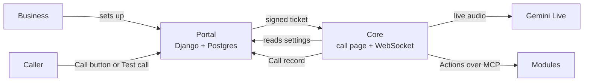

<h1 align="center">Voice</h1>

<p align="center">A live AI voice agent that answers a business's callers, in Swedish or English, from the business's own words.</p>

<p align="center">
  <a href="https://github.com/irma-AI/Voice/actions/workflows/ci.yml"></a>
  <a href="LICENSE"></a>
</p>

<p align="center">
  <a href="https://voice.petterannerwall.se">Portal</a> · <a href="#self-host">Self-host</a> · <a href="ARCHITECTURE.md">Architecture</a> · <a href="GLOSSARY.md">Glossary</a> · <a href="#contributing">Contribute</a>
</p>

## Why Voice?

**Calls answered from plain instructions.** A Business writes what the agent should know and how to act, in its own words, picks Swedish, English or both, and presses Test call. A Call button on the Business's website then lets Callers talk to the agent from the browser.

**Actions you plug in.** Everything the agent does during a call beyond talking comes from a Module, an MCP server the Business adds, combines or swaps. The core runs the call; Modules bring the Actions ([ADR 0001](docs/adr/0001-modules-are-mcp-servers.md)).

**Open code, hosted or yours.** The same core and Portal run as the hosted service and as a copy on your own machine, with your own Google key.

## What works today

- **Portal**: invite-only login, password reset, and settings for a Business's name, Instructions, call languages and Theme (logo and accent colour)
- **Test call**: one button on the dashboard opens a live call with the saved settings
- **Call button**: a script tag for the Business's own website, once a website domain is saved; the browser lets only that site frame the call
- **Modules**: add an MCP server by address, press Check to list the Actions it offers, and the agent can call them in the next call
- **Recent calls**: start, length and kind of each call, on the Business's clock
- **Spend per call**: every call leaves a Call record with tokens and dollar cost (numbers only, never words or audio); a daily budget caps Call button calls per Business
- **Access tokens**: read-only or full tokens a Business makes and revokes in the Portal (Planned: the MCP endpoint that reads them, [ADR 0003](docs/adr/0003-agents-operate-voice-through-one-portal-endpoint.md))

Planned: a phone Channel and Portal translations, Swedish first.

## How a call works



1. The Portal hands the browser a short-lived ticket signed with `CORE_SECRET`; the core opens the call page only for a valid ticket.
2. At call start the core reads the Business's settings from the Portal and connects to the Business's Modules.
3. The call page shows the AI disclosure and the agent opens by saying it, then talks with the Caller through Gemini Live, calling Module Actions as needed.
4. At call end the core sends a Call record (and a Call log of timings) back to the Portal.

The Portal and the core are separate services, so a Portal restart never cuts a live call ([ADR 0002](docs/adr/0002-portal-and-core-are-separate-services.md)). The whole map, with each layer and its one interface: [ARCHITECTURE.md](ARCHITECTURE.md).

## Self-host

The core, the Portal and Postgres on one machine, with your own Google key. Needs Docker only.

1. Download this repo and `cp .env.example .env`. In `.env`, put your Gemini key (aistudio.google.com) after `GOOGLE_API_KEY=`. Calls cost you, not anyone else. Change `CORE_SECRET` from `local` if other people use the machine.
2. Start everything: `docker compose -f compose.self-host.yml up --build` (or `make self-host`). The Portal is at http://localhost:8000 and the call page at http://localhost:7860; both listen on this machine only.
3. In a second terminal, invite yourself. The command prints a plan first; run it again with the hash it shows:
   `docker compose -f compose.self-host.yml exec portal python -m django invite_business you@example.com "Your Business" --target local`
   `docker compose -f compose.self-host.yml exec portal python -m django invite_business you@example.com "Your Business" --target local --execute --approved-hash=<sha256>`
4. The invite email prints in that second command's output (no mail server is set up). Open the link in it; where a line ends in `=` and the text goes on below, join the lines without the `=`. Set a password, log in, and press the test call button.

Stop with `make self-host-down`; your data stays in a Docker volume.

Options in `.env` (each one is described in `.env.example`):

- `TIME_ZONE=Europe/Stockholm` (or your own tz database name) shows times on your clock; the default is UTC.
- `ALLOW_LOCAL_MODULES=1` lets a Business add Modules that run on this machine, or at an http or private address (a local Module's program must exist inside the core's container).
- `BILLING_API_KEY`, a Google key limited to the Cloud Billing API, fills in each call's dollar cost; without one, records carry tokens and an empty cost.

A call opens only from the Portal: a Business's test call button, or the Call button on the Business's own website (the script tag on the dashboard, shown once a website domain is saved). A browser lets only an https website on that domain frame the call page, so the Call button cannot be tried from `http://localhost`; the Test call works anywhere. The Portal runs in local mode here (Django's dev server, mail printed to the log): fine on one machine; a public address needs the production values listed in `.env.example`.

Not checked: a full call from the self-hosted copy (it spends Gemini credit); the steps were run from an empty folder up to the Portal handing the core a signed test-call ticket and the core reading the Business's settings from the Portal.

## Development

Prerequisites: Python 3.13 with [uv](https://docs.astral.sh/uv/), Node.js with npm, and Docker.

```bash
make setup          # uv sync and npm ci
cp .env.example .env  # then put your Gemini key after GOOGLE_API_KEY=
make portal-up      # Portal at http://localhost:8000, Postgres in Docker, migrations applied
make up             # call page at http://localhost:7860 (second terminal)
make check          # everything CI runs
```

Invite yourself into the local Portal with `DJANGO_SETTINGS_MODULE=portal.settings uv run --env-file .env.example --env-file .env python -m django invite_business you@example.com "Your Business" --target local`, then run it again with `--execute --approved-hash=<sha256>` from the plan it prints; the invite email, with the link, prints in that second run's output. Log in and press the test call button. Every call spends Gemini credit. `make help` lists every target.

## Tests and evals

- **Checks** (`make test`, free, in CI): pure functions on stored synthetic call records, plus the cost, settings, Modules and login rules.
- **Portal** (`make test-db`, free, in CI): the Portal through Django's test client against a real Postgres, including each rule the database must refuse.
- **Evals** (`make eval`, paid): Scenarios played against the real agent with stored Caller audio, under the spend caps in `tests/evals/caps.json`. Evals spend Gemini credit, so each run needs the maintainer's approval: locally, or from the manual Evals workflow, never on push or PR. A change to the prompt, the test Business or the Pipecat pin needs a matching `eval-receipt.json`.

## Tech stack

- **Core**: Python 3.13, [Pipecat](https://github.com/pipecat-ai/pipecat) 1.12, Gemini Live, FastAPI and uvicorn
- **Portal**: Django, Postgres, Tailwind CSS, gunicorn and WhiteNoise
- **Modules**: the Model Context Protocol (MCP)
- **Deploy**: Docker images (`Dockerfile` for the core, `Dockerfile.portal` for the Portal), built from `main` on every merge; both carry a health check, and the core waits for open calls to end, at most 630 s, before a deploy stops the core. Hosted at https://voice.petterannerwall.se (Portal) and https://call.petterannerwall.se (call page)

## Repository map

| Path | Purpose |
| --- | --- |
| [`voice/`](voice/) | The core: web Channel, agent, settings, Modules and Call reports |
| [`portal/`](portal/) | The Portal, a Django app with its own Postgres |
| [`modules/`](modules/) | Example Modules (MCP servers) to copy from |
| [`contract/`](contract/) | JSON schemas the Portal and the core share |
| [`tests/`](tests/) | Checks, Portal tests and the eval Scenarios |
| [`scripts/`](scripts/) | Guards, hooks and helper scripts |
| [`docs/`](docs/) | ADRs, privacy, design notes, research and agent docs |

## Documentation

- [ARCHITECTURE.md](ARCHITECTURE.md): layers, dependency direction and the one interface per concern
- [GLOSSARY.md](GLOSSARY.md): the terms (Business, Caller, Module, Action, Call record and more)
- [PRODUCT.md](PRODUCT.md): who Voice is for and what is shipped
- [Architecture decisions](docs/adr/) and [DECISIONS.md](DECISIONS.md)
- [Privacy](docs/privacy/README.md): who processes a call's data, under which terms and for how long

## Contributing

Work here is mostly done by coding agents under the rules in [CLAUDE.md](CLAUDE.md) (read by [AGENTS.md](AGENTS.md) too): every change passes `make check`, has tests at the seams in CLAUDE.md § Tests, and records each non-obvious choice in [DECISIONS.md](DECISIONS.md). Pull requests follow the [template](.github/pull_request_template.md), including three first-principles answers.

## License

[AGPL-3.0-or-later](LICENSE): GNU Affero General Public License, version 3 or any later version.
